# Sentinel — Agentic Fraud Investigation on TigerGraph

**An agent that investigates card fraud on a graph, and knows when not to block.**

Sentinel reads a bank's transaction graph in TigerGraph, finds fraud patterns nobody wrote down, refuses to harm a
customer on a single odd signal, asks a person before it blocks anything, and writes every step into a
tamper-evident record a regulator can check. Anyone at the bank can question it in plain English through
**Ask Sentinel** — and get answers built only from what their role is entitled to see. And a bank with a completely
different graph schema can be brought to the same detectors through one reviewed, signed mapping.

Built for the TigerGraph Agentic Fraud Investigation challenge, Hacker House Goa, by **Team CollabUp**
(Rishit Rastogi, Subhash Bishnoi).

| | |
|---|---|
| 🔗 **Live application** | https://hackerhouse.collabup.co.in |
| 📘 **API reference** | https://apihacker.collabup.co.in/api/docs |
| 💻 **Code** | https://github.com/r-rishit27/hacker_house |
| 🧭 **Design (HLD + LLD)** | [docs/design/ARCHITECTURE.md](docs/design/ARCHITECTURE.md) · [the system on one page](docs/design/SYSTEM_ON_ONE_PAGE.md) |
| ✍️ **Write-up** | [Sentinel: an agentic fraud investigator on TigerGraph that knows when *not* to block](https://medium.com/@r.rishit27/sentinel-an-agentic-fraud-investigator-on-tigergraph-that-knows-when-not-to-block-41b8e706116e) |

---

## At a glance

| | Round 1 | Final |
|---|---|---|
| Benchmark alerts decided correctly, live on the graph | 6 / 20 | **16 / 20** — 3 escalated to a person, 1 wrong |
| Innocent customers blocked | 4 | **0** |
| Undocumented fraud patterns caught | 0 of 2 | **2 of 2** |
| Worst-case investigation time | 170 s | **17 s** |

- **2.0%** of held-out innocent alerts called fraud; **299 of 300** held-out frauds kept.
- **0** prompt-injection attempts flipped a verdict (36 defended runs).
- **0** sources outside the asking role ever sent to the model by Ask Sentinel.
- **3** unrelated bank schemas (ISO 20022, BIAN, Temenos T24) on the same detectors: 79 / 79 mapping items right after
  review, the same fraud found live in all three.
- **Every** step — query, detector, model score, decision, approval, refusal, sign-in — on a SHA-256 hash chain.

---

## Sign in and look around

The application is live. Sign in with any of these and you see exactly what that role may see and do; the server
enforces every permission.

| Username | Role | Password | Lands on |
|---|---|---|---|
| `analyst.raj` | Analyst | `DhQoOakT2y5g` | Case console |
| `lead.priya` | Team lead | `NKzeymnl_qHu` | Case console |
| `manager.anika` | Fraud manager | `yDme8E6s7CVN` | Case console |
| `examiner.ines` | Regulator | `0xVI4eIvFI7p` | Regulator overview |

*Demo accounts on demo data, published on purpose for reviewers. Five wrong passwords lock an account for 15 minutes.*

| | Analyst | Team lead | Fraud manager | Regulator |
|---|:-:|:-:|:-:|:-:|
| Alert queue, start an investigation | ✓ | ✓ | ✓ | – |
| Case file: timeline, probability trajectory, graph, evidence, SAR | ✓ | ✓ | ✓ | ✓ read-only |
| A case's step-by-step audit trail | ✓ | ✓ | ✓ | ✓ |
| Approve **L1** actions (block card, decline) | – | ✓ | ✓ | – |
| Approve **L2** actions (file report, block all cards) | – | – | ✓ | – |
| Full audit trail, hash-chain verification, change record | – | – | ✓ | ✓ |
| Regulator overview and examiner walkthrough | – | – | ✓ | ✓ |
| Who has access | – | – | ✓ | – |
| **Ask Sentinel** — answers only from what this role may see | ✓ | ✓ | ✓ | ✓ |

**A five-minute tour**

1. **As `analyst.raj`**, open HHG-014. Watch each finding move the probability, and the ring appear in the case graph.
   Try to approve the block — the server refuses, and the refusal is itself an audit entry.
2. **Press the tiger button — Ask Sentinel.** Ask *"Why was HHG-014 called fraud? Cite the evidence."* Then ask
   *"Who failed to sign in?"* — the analyst may not see the access log, so the answer names the missing permission
   and reveals nothing from it.
3. **As `lead.priya`**, approve the L1 block. The L2 report stays waiting for a fraud manager.
4. **As `manager.anika`**, approve the report and open *Regulator overview*.
5. **As `examiner.ines`**, walk an investigation step by step and press *Re-verify chain* to recompute every hash in
   your own browser.

### Screenshots

**Fraud manager** — the case console: the queue, HHG-014's probability trajectory with every finding cited to the
GSQL query behind it, the case graph and the next best action.

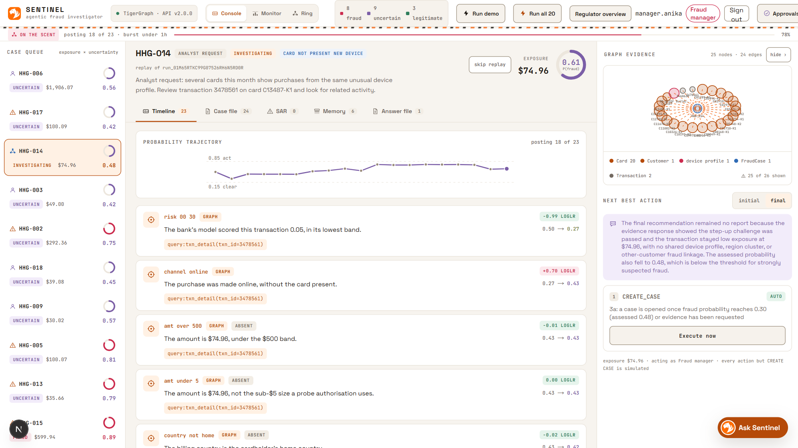

**Ask Sentinel, as the fraud manager** — every kind of record in scope; the answer cites HHG-014's audit trail.

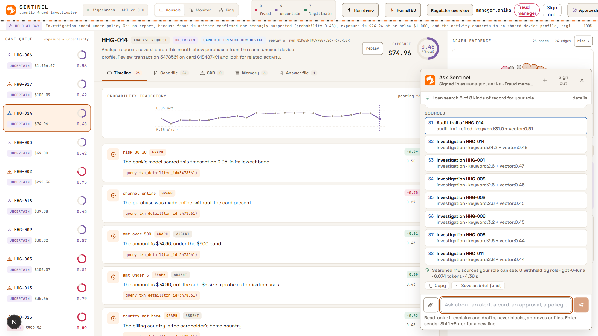

**The approval inbox** — L1 and L2 actions wait here for a person; the role is checked on every decision.

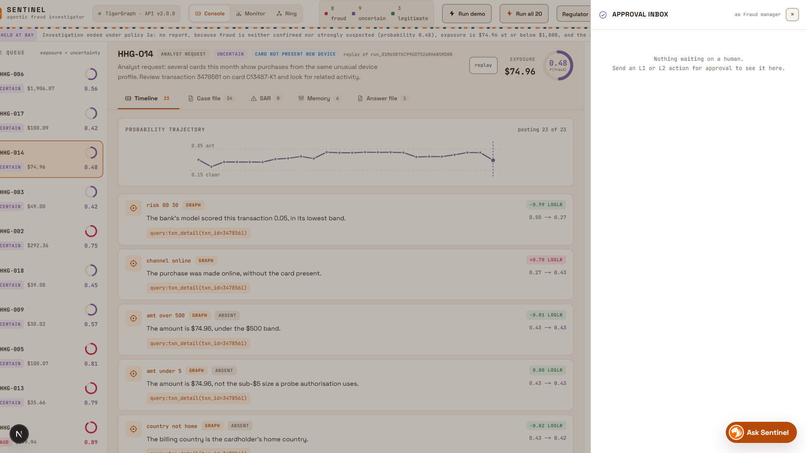

**Regulator** — the read-only Examiner Register: every investigation, approvals awaiting a person, refused attempts.

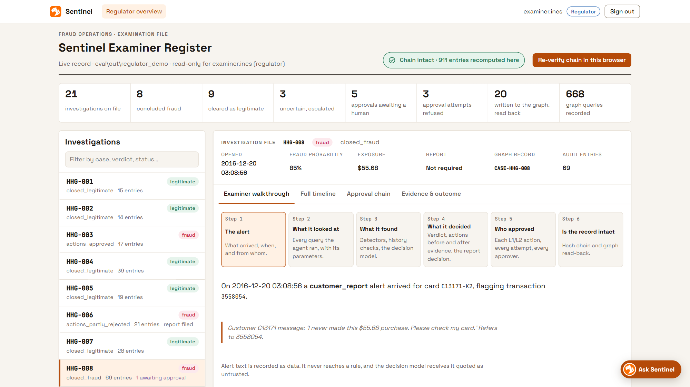

**Re-verify the chain** — every hash in the audit ledger recomputed in the examiner's own browser, without trusting
the server.

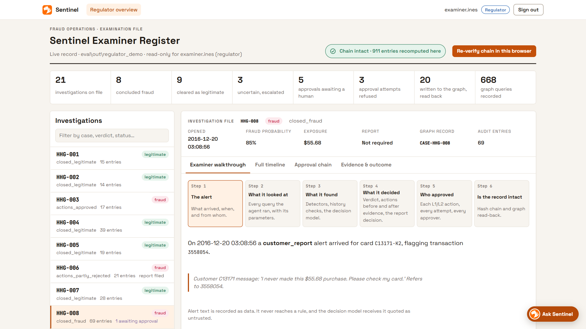

**One investigation, step by step** — the alert, what Sentinel looked at, what it found, what it decided.

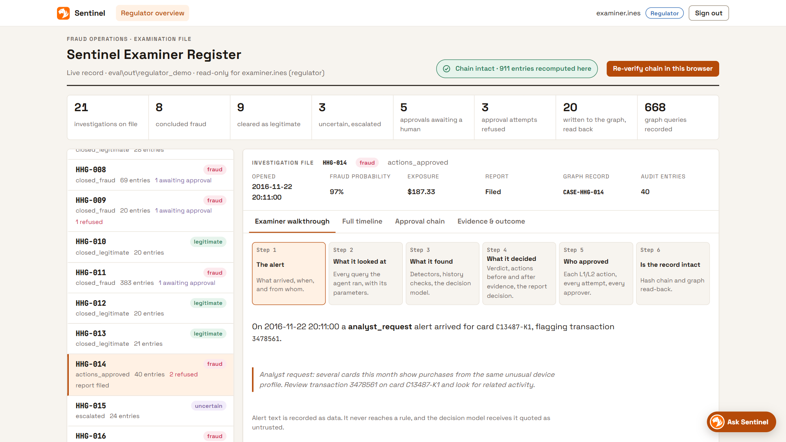

**Ask Sentinel, as the regulator** — the one kind of record this role may not see is withheld before ranking and
never reaches the model.

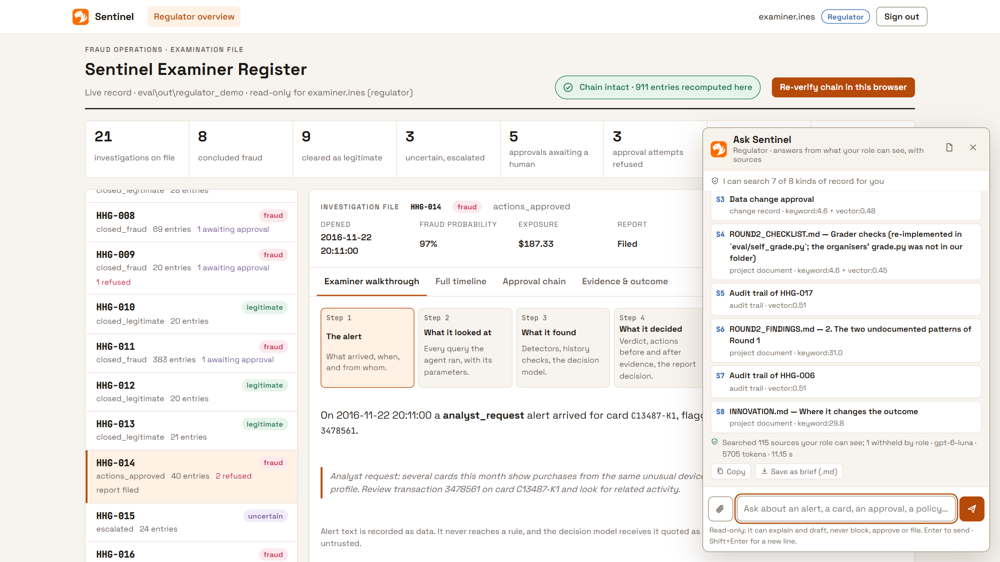

---

## What it does


| | |
|---|---|
| **Investigation on the graph** | 8 detectors for patterns nobody wrote down — structuring under a threshold, a device ring adopted by many cards, a known ring device returning, dormant cards waking, escalating charges, micro-charges, many cards paying one recipient, card testing. Rings are found by label propagation inside TigerGraph |
| **History checks** | Six look-alike tests from the bank's own cleared cases: an anomaly the card's history explains does not count against the customer. This took innocent customers blocked from 4 to 0 |
| **Rules first, model second** | Decisive detectors, customer denials, explained alerts and single weak signals are settled by rules. Only genuinely ambiguous cases reach the OpenAI Decisions API — and it may not block on its own |
| **Policy engine** | The bank's Fraud Policy as tested code: R1–R10, the §3a report rule, approval routes auto / L1 / L2 — recomputed before and after every evidence request |
| **Human approval** | L1 actions wait for a team lead, L2 for a fraud manager; every grant and refusal is recorded |
| **Containment planner** | For a ring, blocks the cards whose exposure outweighs the cost of disrupting a cardholder, and monitors the rest |
| **Write-back** | Each case becomes a `FraudCase` in the graph, marked saved only after it reads back identically |
| **Audit trail** | Append-only; every entry carries the SHA-256 of the one before — edit anything and the chain breaks exactly there |
| **Regulator view** | Every investigation, its approval chain, the change record, an examiner walkthrough and in-browser hash verification |
| **Ask Sentinel** | A permission-aware GraphRAG copilot over investigations, audit trails, the live graph, closed-case vectors and your own documents |
| **Bank onboarding** | Any bank's graph schema mapped onto Sentinel's canonical model — proposed by a model, validated by code, reviewed by a person, signed by a team lead |
| **Restricted MCP tools** | Five read-only tools for an assistant or IDE. No raw query, no write, every call audited |

---


## The innovation: Ask Sentinel

> **A permission-aware GraphRAG copilot: anyone at the bank asks the fraud graph a question in plain English and gets
> a cited answer built only from what their role is entitled to see. Entitlement is enforced before retrieval, so the
> model never receives what the user may not read.**

Most enterprise copilots filter the answer. Sentinel filters the context. In a regulated bank that is the difference
between *"the model was told not to say it"* and *"the model never had it."*

1. **Entitlement first** — every source carries the permission it needs; what the role lacks is dropped before
   ranking. The answer can say *"your role lacks `audit.all`"*, never what that material contains.
2. **Untrusted text stays data** — questions, uploads and sources are scanned for instruction-like wording and passed
   to the model as quoted data.
3. **Every claim cited, every citation checked** — citations to sources the model was not given are removed; an
   uncited answer is marked unverified; personal data is masked.

Retrieval fuses graph facts, closed-case vectors, embeddings and exact-id matching by reciprocal rank fusion; every
question is an entry on the audit chain. Measured live: an analyst asking for the access log gets *"not in what you
can see"* with the permission named, and nothing from the log reaches the model; a fraud manager gets the real
approval chain, every claim cited.

---

## The OpenAI Decisions API — the model on a leash

For the cases the rules cannot settle, Sentinel calls OpenAI's **Decisions API (`gpt-6-luna`)**. It does not ask for a
verdict. It asks five questions it wrote itself, and gets back **five calibrated probabilities** — never prose:

| Predicate | The question |
|---|---|
| `is_fraud` | is this transaction fraud? |
| `history_explains` | does the card's own history explain what looks odd? |
| `coordinated` | is it part of something across several cards? |
| `evidence_conflicts` | does the evidence point both ways? |
| `text_instructs` | does the alert text contain instructions aimed at an automated system? |

Code — not the model — turns the numbers into a verdict, behind hard gates: the model may not block a single charge
on its own, may not overrule a detector or a customer's denial, and an uncertain result is capped below the
report-filing threshold. If the call fails, the case becomes *uncertain, escalated to a person* — never a guess. The
alert text is normalised and quoted as untrusted, so there is nothing for an injected instruction to steer except five
numbers that are checked against the evidence: **0 of 36 defended runs flipped.**

---

## Bring any bank's graph

Every bank names things differently: ISO 20022 calls a payer `Dbtr`; BIAN reaches an account through a party, a plan
and a facility; Temenos T24 stores dates as `YYMMDDHHMM` strings next to a ledger table that looks like transactions
but isn't. Sentinel's detectors read a narrow canonical model instead, and a new bank is onboarded by mapping onto it:
**propose** (from the schema's structure only) → **validate** (every name and path checked against the real schema)
→ **review** (a person supplies code tables and filter values, with a reason per change) → **approve** (signed,
bound to the mapping's hash) → **run** the unchanged detectors on the bank's own graph. A detector a bank cannot feed
is switched off with the reason. Measured on three schemas built with traps: **79 / 79 right after review, 0 wrong**,
the same fraud found live in all three. Detail: [docs/ONBOARDING.md](docs/ONBOARDING.md).

---

## Architecture

```
Alert ─▶ Validate ─▶ Batched graph read ─▶ 8 detectors ─▶ History checks ─▶ Rules ─▶ (Decisions API, ambiguous cases only)
      ─▶ Policy engine ─▶ Containment ─▶ Human approval ─▶ Write-back & read-back ─▶ Audit chain
                       Ask Sentinel answers over all of it, within each role
```

Facts come from TigerGraph, belief from detectors and the bank's own history, decisions from rules and a policy
engine. The model scores only what the rules cannot settle, and a person approves every block and every report.

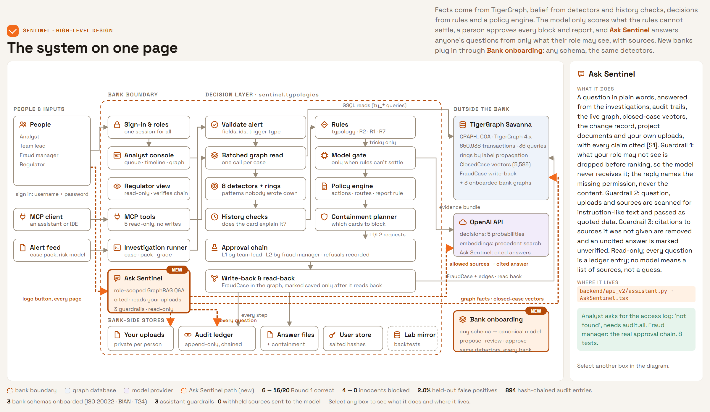

| Component | What |
|---|---|
| **Analyst console** (Next.js) | sign-in, case queue, live timeline and probability trajectory, case graph, approvals, the regulator view and Ask Sentinel — one application, one signed session |
| **Sentinel API** (FastAPI) | investigations streamed live, cases, actions and approvals, the audit ledger and change record, Ask Sentinel, restricted MCP tools |
| **TigerGraph Savanna 4.x** | the source of truth: 650,938 transactions, 5,585 closed cases with vectors, 36 GSQL queries, Sentinel's own case records, and each onboarded bank's graph |
| **OpenAI** | the Decisions API for ambiguous cases, embeddings, and Ask Sentinel's cited answers — pseudonymous ids only |

**An alert, step by step** — HHG-014, a device ring: the detector fires, the policy engine asks for a block and a
report, an analyst is refused, a team lead and a fraud manager approve, and every step is an audit entry.

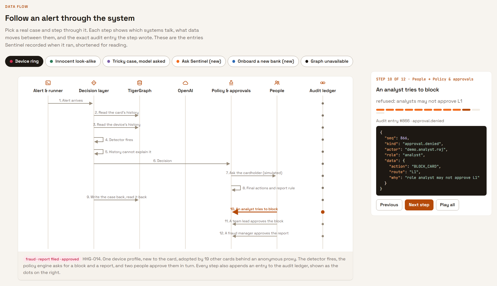

**Ask Sentinel, step by step**

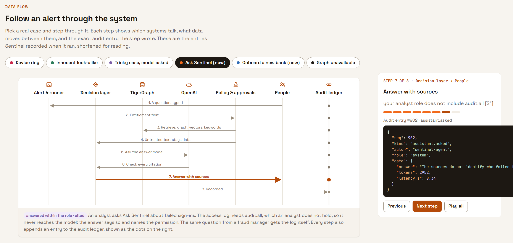

**Onboarding a new bank**

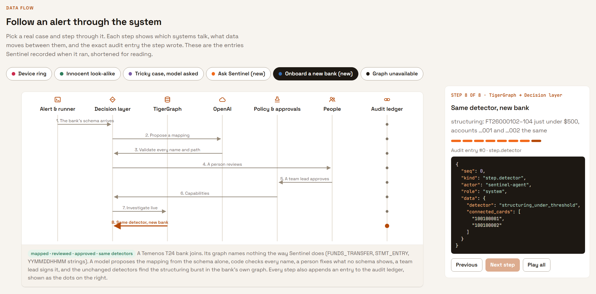

**Classes and how they connect**

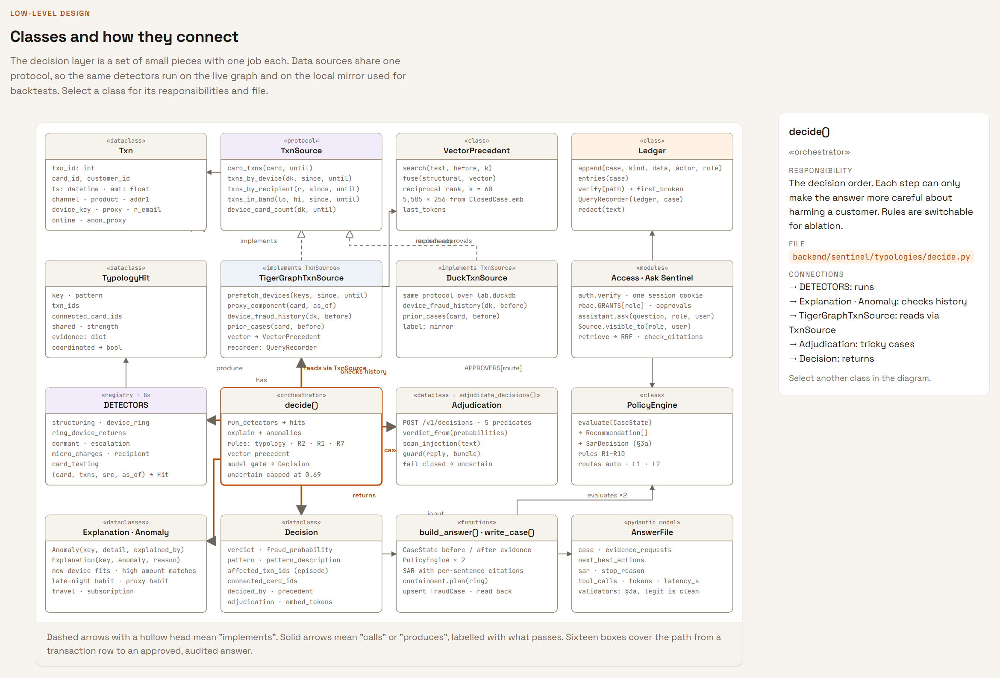

### Technology stack

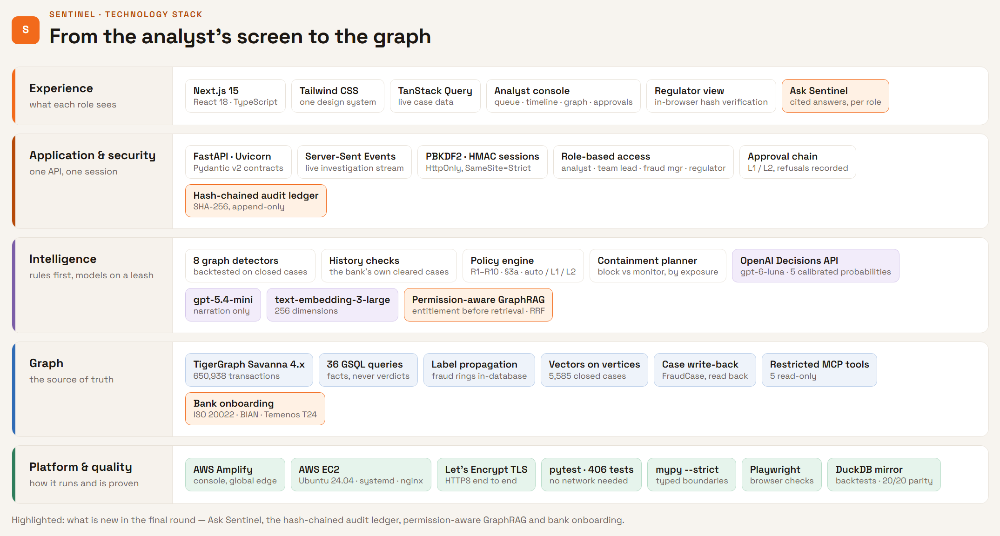

---

## Deployed on AWS

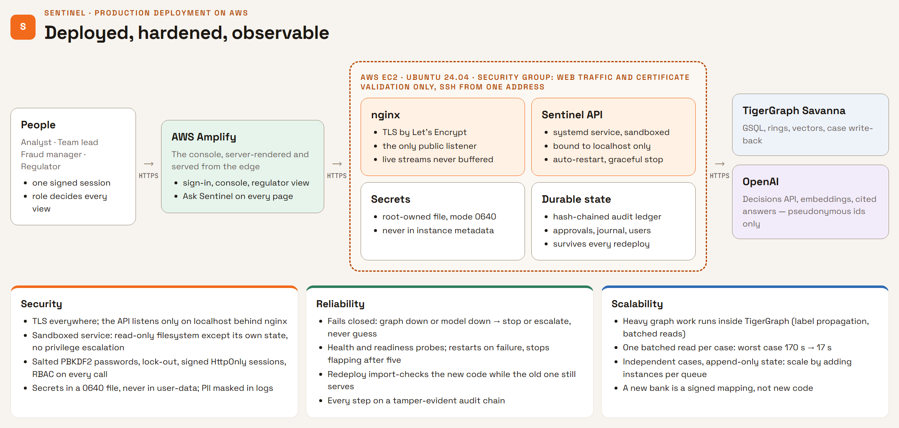

The console is served by **AWS Amplify**; the Sentinel API runs on **AWS EC2** behind nginx; TigerGraph Savanna and
OpenAI are reached over HTTPS.

**Security**
- TLS end to end (Let's Encrypt). nginx is the only public listener; the API is bound to localhost and unreachable
  from outside the instance. The security group admits web traffic and certificate validation, and SSH from one
  address only.
- The API runs as a dedicated, unprivileged systemd service in a sandbox: the filesystem is read-only except its own
  state directory, with no privilege escalation, private temp, and protected kernel and home.
- Secrets live in a root-owned file readable only by the service — never in instance user-data, which the metadata
  service exposes.
- Salted PBKDF2 passwords with lock-out; HttpOnly, SameSite=Strict signed sessions; role-based access checked on every
  call; e-mail addresses, card-number-like and phone strings masked in logs.

**Reliability**
- Fails closed: an unreachable graph stops the case and writes nothing; a failed model call escalates to a person.
- Liveness and readiness probes; restart on failure, and a stop after five failures a minute so a broken release is
  visible instead of flapping. Graceful shutdown lets an in-flight investigation finish its step.
- Every redeploy import-checks the new revision while the old one is still serving, then restarts and confirms health.
  The audit ledger, approvals and event journal survive every redeploy.
- The idle TigerGraph workspace is detected and waited for, rather than reported as an error.

**Scalability**
- The heavy lifting runs inside TigerGraph: rings by label propagation, one batched read per case (worst case
  170 s → 17 s, typical 1.5–6 s).
- Investigations are independent and state is append-only, so throughput scales by adding instances against the same
  graph, each working its own queue.
- A new bank is a reviewed, signed mapping — not new code.

---

## Rules this project holds to

1. **No graded field comes from free-form model text.** Ids, amounts, exposure, actions, routes and the report
   decision come from a GSQL query or the policy engine; every id is checked before an answer is written.
2. **Fail closed.** A graph that does not answer, a malformed alert or a model that times out stops the case and says
   why — nothing is guessed.
3. **A person approves.** Blocks and reports wait for the right role; data changes and bank mappings wait for a signed
   approval bound to exactly what was reviewed.
4. **The public IEEE-CIS / Kaggle files are never opened.** They were not downloaded, opened or referenced.

---

## The dataset

IEEE-CIS Fraud Detection (Vesta Corporation), repackaged by TigerGraph and extended for the final round with January
2017: **650,938 transactions** from July 2016 to January 2017, identity records for online purchases, **5,585 closed
investigations** — the only place ground truth is written down — and the benchmark alerts. Every transaction carries a
risk score from the bank's model; there is no fraud label.

---

## Documents

| | |
|---|---|
| [docs/design/ARCHITECTURE.md](docs/design/ARCHITECTURE.md) | HLD and LLD: system map, data flows, classes, deployment, pillars, logs |
| [docs/design/SYSTEM_ON_ONE_PAGE.md](docs/design/SYSTEM_ON_ONE_PAGE.md) | The system on one page |
| [docs/ROUND2_FINDINGS.md](docs/ROUND2_FINDINGS.md) | What changed in the final round, and the evidence |
| [docs/INNOVATION.md](docs/INNOVATION.md) | The innovation claim and its measurement |
| [docs/ONBOARDING.md](docs/ONBOARDING.md) | Onboarding a bank's schema, measured on ISO 20022, BIAN and T24 |
| [docs/RESILIENCE.md](docs/RESILIENCE.md) | Failures, drills, and what leaves the bank's boundary |
| [docs/ROUND2_CHECKLIST.md](docs/ROUND2_CHECKLIST.md) | Every requirement in the brief and where it is met |
| [docs/TOOLS_AND_MCP.md](docs/TOOLS_AND_MCP.md) | Tools, GSQL queries and the MCP server |
| [deploy/Deployment_Doc.md](deploy/Deployment_Doc.md) | The AWS deployment in full |
| [docs/ROUND2_RUN.md](docs/ROUND2_RUN.md) | Reproducing every result |

---

Roughly half the benchmark cases are legitimate, and an agent that blocks everything scores badly. That single
constraint drives most of the design.
